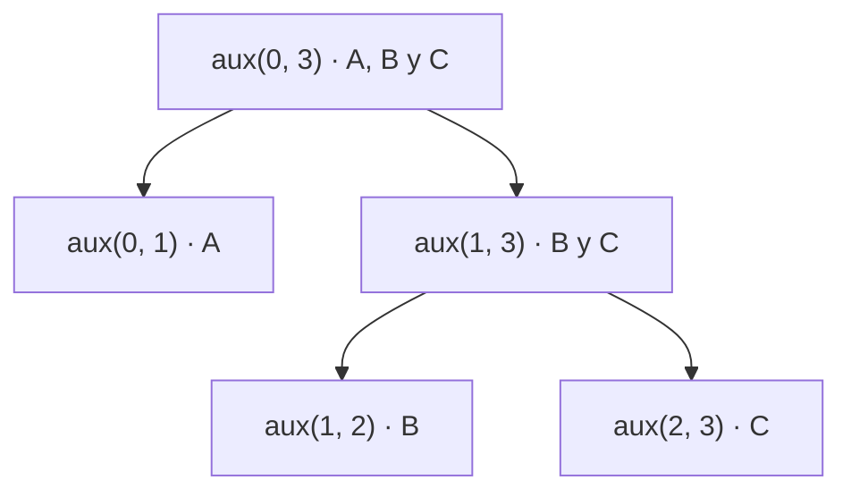

En este taller trabajamos con partículas. De cada una conocemos su posición, la velocidad con la que se mueve y su masa. Para seguir los llamados vamos a usar el mismo arreglo en los primeros tres puntos.

| Índice | Partícula | Posición | Velocidad | Masa |
|---:|---|---|---|---:|
| 0 | A | (-1, 0) | (2, 0) | 1 |
| 1 | B | (3, 1) | (0, -1) | 2 |
| 2 | C | (1, 2) | (0, 0) | 1 |

Llamamos `s` a este arreglo. Para el movimiento tomamos `dt = 0.5`. En los cálculos de energía y centro de masa usamos las posiciones originales de la tabla.

## 1. Un paso de la simulación

### Mover una partícula

`mover` recibe una partícula y el tiempo que pasa. Primero multiplica la velocidad por `dt`. Después suma ese cambio a la posición que tenía.

Para A, el cálculo queda así:

```text
Posición inicial       (-1, 0)
Velocidad por tiempo   (2, 0) * 0.5 = (1, 0)
Posición nueva         (-1, 0) + (1, 0) = (0, 0)
```

La respuesta es `Particula(Vector2(0, 0), Vector2(2, 0), 1.0)`. A llegó al origen y conserva su velocidad y su masa.

### Avanzar un tramo o el arreglo completo

En `pasoSegmento(s, 0.5, 1, 3)`, el primer índice que se toma es 1 y el último es 2. `hasta` indica dónde termina el tramo y queda por fuera.

| Lugar en el arreglo nuevo | Índice que se lee en `s` | Cálculo | Posición obtenida |
|---:|---:|---|---|
| 0 | 1 | (3, 1) + (0, -0.5) | (3, 0.5) |
| 1 | 2 | (1, 2) + (0, 0) | (1, 2) |

Aunque B estaba en el índice 1, queda de primera en la respuesta porque el tramo empezó allí. C permanece en el mismo lugar porque su velocidad es cero.

`pasoSecuencial(s, 0.5)` llama a `pasoSegmento(s, 0.5, 0, 3)`. Ahora también entra A. Las posiciones que devuelve son `(0, 0)`, `(3, 0.5)` y `(1, 2)`, en ese orden.

### Repartir el movimiento

Para `pasoParalelo(s, 0.5, 1)`, cada tramo se sigue partiendo hasta tener una sola partícula. La primera llamada es `aux(0, 3)`. Como hay tres elementos, quedan uno a la izquierda y dos a la derecha.



Los tres llamados de abajo usan `pasoSegmento`. Una vez movidas las partículas, los arreglos se unen así:

```text
aux(1, 3) junta [B movida] con [C movida]
aux(0, 3) junta [A movida] con [B movida, C movida]
Resultado: [A movida, B movida, C movida]
```

La parte izquierda siempre se coloca primero. Por eso C sigue de última aunque su cálculo termine antes que el de A.

## 2. Energía, masa y centro de masa

### `energiaSecuencial`

La energía de cada partícula se obtiene con $\frac{1}{2}mv^2$, donde $v$ es su rapidez. `foldLeft` empieza con una suma de `0.0` y la actualiza al leer cada elemento.

| Partícula | Rapidez | Energía que aporta | Suma hasta ese momento |
|---|---:|---:|---:|
| A | 2 | 0.5 × 1 × 4 = 2 | 2 |
| B | 1 | 0.5 × 2 × 1 = 1 | 3 |
| C | 0 | 0 | 3 |

B se mueve hacia abajo. Su velocidad tiene una coordenada negativa, pero su rapidez es 1. Al terminar, `energiaSecuencial(s)` devuelve `3.0`.

### `masaTotal`

Aquí se acumula la masa de cada elemento.

```text
Inicio       0
Después de A 0 + 1 = 1
Después de B 1 + 2 = 3
Después de C 3 + 1 = 4
```

La masa total es `4.0`.

### `centroDeMasaSecuencial`

Esta función lleva dos datos en el mismo recorrido. Uno guarda la suma de cada posición multiplicada por su masa. El otro lleva la masa acumulada.

| Momento | Posición por masa que se agrega | Suma de posiciones por masa | Masa acumulada |
|---|---|---|---:|
| Inicio | — | (0, 0) | 0 |
| Después de A | (-1, 0) × 1 | (-1, 0) | 1 |
| Después de B | (3, 1) × 2 | (5, 2) | 3 |
| Después de C | (1, 2) × 1 | (6, 4) | 4 |

Al final se multiplica `(6, 4)` por `1.0 / 4.0`. El centro queda en `Vector2(1.5, 1.0)`. Si la masa acumulada es cero, se devuelve el origen.

## 3. Las mismas cuentas en paralelo

### `energiaParalela`

Con umbral 1 se forman los mismos tramos del diagrama del punto 1. Ahora cada llamado entrega un número.

```text
sumar(0, 1) → energía de A → 2
sumar(1, 2) → energía de B → 1
sumar(2, 3) → energía de C → 0

sumar(1, 3) → 1 + 0 → 1
sumar(0, 3) → 2 + 1 → 3
```

El total coincide con el recorrido secuencial.

### `centroDeMasaParalelo`

Cada parte devuelve una pareja con la suma de posiciones por masa y la masa del tramo.

| Llamado | Qué reúne | Pareja que devuelve |
|---|---|---|
| `sumar(0, 1)` | A | `((-1, 0), 1)` |
| `sumar(1, 2)` | B | `((6, 2), 2)` |
| `sumar(2, 3)` | C | `((1, 2), 1)` |
| `sumar(1, 3)` | B y C | `((7, 4), 3)` |
| `sumar(0, 3)` | A, B y C | `((6, 4), 4)` |

La división se hace cuando ya están reunidas las tres partículas. La coordenada horizontal queda en `6 / 4 = 1.5` y la vertical en `4 / 4 = 1.0`.

## 4. Trabajo, profundidad y tiempo estimado

`trabajo(17)` devuelve 17. Aunque se repartan las partículas, todavía hay que mover las 17.

Para seguir `profundidad(17, 8)` escogimos un tamaño impar. Este caso muestra por qué el código revisa tanto el tramo menor como el mayor.

1. `profundidadNivel(1, 0)` empieza con un tramo de 17 y cero divisiones. Como 17 supera el umbral, pasa a `profundidadNivel(2, 1)`.
2. Con dos tramos, el menor tiene 8 partículas y el mayor tiene 9.
3. El de 8 ya cabe. Desde ese punto cuesta 8 operaciones.
4. El de 9 se divide en 4 y 5. Por ese lado queda una división y luego un tramo de 5. Su costo es `1 + 5 = 6`.
5. Las dos partes pueden avanzar a la vez. Hay que esperar la que más tarda, así que se toma el mayor entre 8 y 6. Al contar también la primera división, la profundidad da `1 + 8 = 9`.

Con cuatro procesadores, `tiempoEstimado(17, 4, 8)` reúne los dos resultados:

$$
9+\frac{17}{4}=9+4.25=13.25
$$

Son unidades del modelo que pide el taller. Los tiempos en milisegundos se obtienen al ejecutar el programa.

## 5. Medición y elección del umbral

`medir(5)` usa ScalaMeter para calentar la máquina virtual y tomar cinco muestras. Luego las ordena y escoge la que queda en la mitad. Por ejemplo, si las muestras fueran `[8, 5, 7, 9, 6]` ms, el orden sería `[5, 6, 7, 8, 9]` y devolvería `7` ms.

`aceleracion` divide el tiempo secuencial entre el paralelo. Si un paso tarda 12 ms en secuencial y 8 ms al repartirlo, la aceleración es $12/8=1.5$.

`umbralConveniente` prueba los candidatos recibidos. Supongamos que la lista es `List(2, 4, 8)` y que al medir cada opción se obtienen estas parejas:

```text
(2, 9 ms)
(4, 6 ms)
(8, 7 ms)
```

`minBy(_._2)` compara el segundo dato de cada pareja. Escoge `(4, 6 ms)` y `._1` recupera el umbral 4. Estos números sirven para seguir el ejemplo. Las mediciones del equipo aparecen en el informe de paralelización.

Con una lista vacía se devuelve `s.length`. Así todo el arreglo cabe en un solo tramo.